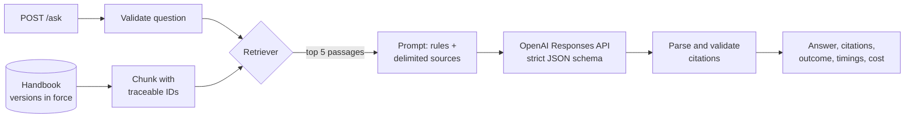

# Document-Grounded Operations Assistant with Evaluation

An API that answers staff questions from a versioned operations handbook. Each answer cites the passages it relies on. When the handbook doesn't cover a question the API says so, and when two documents disagree it reports both. A retrieval experiment and a frozen 60-question evaluation set measure retrieval and answer quality separately.

The handbook belongs to Fernhollow Distribution, a fictional company invented for this project: 16 documents (19 versions, one Markdown file each) covering incidents, change control, expenses, travel, security and suppliers ([data/handbook](data/handbook)).

## Results

<!-- results:start -->
Results appear here after the frozen evaluation has been run (`python -m ops_assistant eval publish`).
<!-- results:end -->

## What it does

- **Uses only the versions in force.** For each document, the version in force on the configured date is selected. Superseded and future-dated versions are never indexed, so the model can't see or cite them.
- **Retrieves with keywords, embeddings or both.** BM25 (written out in [keyword.py](src/ops_assistant/retrieval/keyword.py)), OpenAI `text-embedding-3-small` with cosine similarity, or the two combined by reciprocal rank fusion.
- **Answers in a fixed structure.** The OpenAI Responses API with a strict JSON schema returns an answer, citations and one of three outcomes: `answered`, `insufficient_evidence` or `conflicting_evidence`.
- **Checks citations.** Every cited ID must exist and must have been supplied to the model for that question. Invalid IDs are removed and reported. An answer with no valid citation is rejected rather than shown.
- **Separates failures from refusals.** A timeout, outage, exhausted credit or malformed model reply returns an error with its own category and HTTP status. "The handbook doesn't say" is a normal answer.
- **Measures every request.** Each response carries a request ID, the retrieval and generation time, token counts and the estimated cost, and the same fields are written to a JSON log line.



More detail is in [docs/architecture.md](docs/architecture.md).

## Run it

Windows PowerShell, from the repository folder, with Python 3.13:

```powershell
py -3.13 -m venv .venv
Set-ExecutionPolicy -Scope Process -ExecutionPolicy Bypass
.\.venv\Scripts\Activate.ps1
python -m pip install -r requirements-dev.lock
python -m pip install -e . --no-deps
pytest
```

The tests use a mock provider and need no API key.

**Without an API key**, the service runs with keyword retrieval and an extractive mock in place of the model. This mode checks the plumbing; the mock doesn't reason, so it says nothing about answer quality.

```powershell
$env:OPS_PROVIDER = "mock"; $env:OPS_RETRIEVAL_MODE = "keyword"
python -m ops_assistant serve
```

Open http://127.0.0.1:8000 for the demo page, or http://127.0.0.1:8000/docs for the generated API docs.

**With OpenAI**, set `OPENAI_API_KEY` as an environment variable. It is read only from the environment and never from a file in the repository. Then run:

```powershell
python -m ops_assistant corpus      # documents in force and versions excluded
python -m ops_assistant index       # embed the chunks once (cached in data/index)
python -m ops_assistant ask "What mileage rate can I claim for my own car?"
python -m ops_assistant serve
```

**With Docker:**

```powershell
docker build -t ops-assistant .
docker run --rm -p 8000:8000 --env-file .env ops-assistant
```

`.env.example` lists the variables; copy it to `.env` and add a key. Without one, add `-e OPS_PROVIDER=mock -e OPS_RETRIEVAL_MODE=keyword`. The container runs the same service locally; it is not a production deployment.

## Evaluation

There are two labelled question sets ([eval/](eval)):

| Set | Cases | Used for |
|---|---|---|
| Development | 24 | Choosing the retrieval method and checking the prompt |
| Frozen | 60: 30 supported, 10 unsupported, 10 multi-document, 10 adversarial | Reporting, run once the configuration was fixed |

Half of the supported questions use everyday wording instead of the handbook's own terms ("my work computer" for "laptop", "the capital" for "London"), so that retrieval is tested on more than shared vocabulary. The adversarial cases include questions built on an out-of-date figure, a policy that hasn't come into force yet, conflicting documents, and prompt-injection attempts in both the question and an external document.

Each case records the expected outcome, the handbook sections that support it, and the facts a correct answer must contain. The frozen file is hashed (`eval/frozen_cases.sha256`), and the runner refuses to run it if the hash has changed.

Retrieval and answers are scored separately:

- **Retrieval:** hit rate, recall of the required sections, and mean reciprocal rank at k = 5, over every retrieval configuration.
- **Answers (automatic):** the right outcome, every key fact present, no forbidden phrase, and citations that point to a relevant section.
- **Answers (human):** a person marks each frozen answer as correct or not, and records whether its cited passages actually support it. A citation can point to a real passage that doesn't support the claim; ID validation can't detect that.

```powershell
python -m ops_assistant eval retrieval --set dev
python -m ops_assistant eval answers --set dev --mode embedding
python -m ops_assistant eval answers --set frozen
```

Each run saves its settings, the model the API reported, the case-file hash, the corpus fingerprint and the commit, alongside every raw response ([eval/results](eval/results)). The full method and its limits are in [docs/evaluation.md](docs/evaluation.md).

## Design decisions

The main choices and the evidence behind them are recorded in [docs/decisions.md](docs/decisions.md). In short:

- **Embedding retrieval, chosen on the development set.** Embeddings found the evidence for a paraphrased question that keyword search missed, and hybrid fusion added nothing on this corpus. The measurements are in the decision log.
- **NumPy instead of a vector database.** About a hundred chunks fit in one array, and a search is a single matrix product. A database would be another service to run, with nothing to gain at this size.
- **BM25 written out rather than imported.** It is the baseline everything else is measured against, so every step of the scoring should be visible.
- **Chunks never cross a section boundary by default.** Evidence is labelled by section, and the experiment compares this with fixed windows that do cross sections.
- **Citations are validated in code.** The schema guarantees the shape of the reply, not that its citations are real or were supplied to the model.
- **A provider interface with a mock.** Tests and CI run without network access or cost, and another provider can be added in a single module.

## Limitations

- The handbook and both question sets were written for this project. Sixty cases show how the system behaves on these categories; they don't establish accuracy on real staff questions.
- The automatic answer check matches expected facts as text. The human review is the reference for correctness and support.
- The prompt rules and the delimiting of source text reduce, but don't eliminate, the risk from instructions hidden in documents.
- One model and one provider were evaluated, at the prices and model versions recorded with each run.

## Repository layout

```
config/settings.toml        all settings; a few can be overridden by environment variables
data/handbook/              the fictional handbook, one file per document version
src/ops_assistant/
    corpus.py               metadata validation and the effective-document rule
    chunking.py             section and window chunking with traceable IDs
    retrieval/              BM25, embeddings, hybrid fusion
    llm/                    provider interface, OpenAI adapter, offline mock
    prompting.py            instructions, prompt layout, answer schema
    answer.py               the answering pipeline and citation checks
    api.py                  FastAPI service and error handling
    evaluation/             cases, runner, scoring, reports, human review
eval/                       development and frozen cases, run results
tests/                      deterministic tests with mocked providers
docs/                       architecture, evaluation method, decisions, API examples
```

## Licence

MIT
